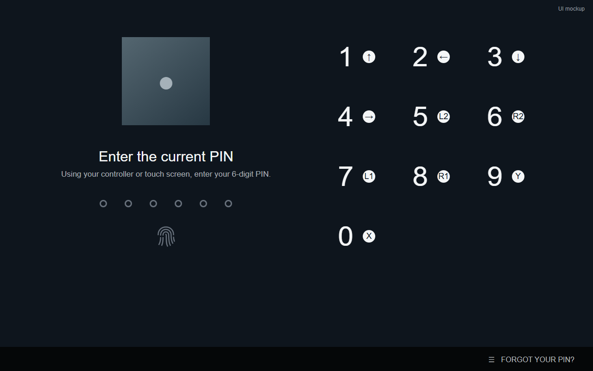

# Fingerprint Unlock for SteamOS



A Decky plugin for unlocking SteamOS with a fingerprint while keeping PIN unlock available. Compatibility depends on your device and fingerprint driver.

## Installation

Install Decky Loader, your fingerprint driver and fprintd first, and enroll a fingerprint. Run as your normal user:

```sh
curl -fsSL https://raw.githubusercontent.com/FlightDan/FingerprintUnlock-SteamOS/86f4d757dd4c3acdff2e2c04f1314aa787311595/install-online.sh | sh
```

For an offline checkout, run from the repository directory:

```sh
sudo sh install.sh
```

The installer uses `/usr/bin` for fprintd tools by default; use `--fprintd-bin /path/to/bin` for a root-managed alternative. On a Boiler-managed OXP3, use Boiler maintenance instead.

## License

Boiler code: [AGPL-3.0](COPYING). The bundled upstream project retains its [MIT license](upstream/LICENSE).
